  

  <h1>Rafhael James Olayres</h1>
  
<strong>Full-stack developer · IT student · Valenzuela City, Philippines</strong>

  
I turn complex ideas into useful web and mobile products, AI-assisted tools, and game experiences.

  

    <a href="https://olayresportfolio.vercel.app/">Portfolio</a> ·
    <a href="https://olayresportfolio.vercel.app/resources/olayres-resume-2026.pdf">Résumé</a> ·
    <a href="https://linkedin.com/in/james-olayres-888721410">LinkedIn</a> ·
    <a href="mailto:olayres.rafhaeljames@gmail.com">Email</a>
  

---

## Currently building

- **PNP Internship Database Tracking Management System:** Developing a workspace for attendance, records, documents, evaluations, and project tracking with the Camp Crame ITMS Office's Special Project Management Team.
- **AgapAI:** Leading the technical work on a capstone project that connects seniors, guardians, and local responders for emergency and health support.

I'm studying BS Information Technology at **Pamantasan ng Lungsod ng Valenzuela** (2023–2027).

## Featured work

### [PNP Internship Database Tracking Management System](https://olayresportfolio.vercel.app/pnp-idtms-case-study.html)

**Full-stack developer · React, Express, Supabase**

A role-aware internship workspace for attendance, daily time records, documents, evaluations, and project tracking. I built the interface, API, data model, and authorization workflows. [Explore the project](https://pnp-itms-internship-attendance.vercel.app/).

### [AgapAI](https://olayresportfolio.vercel.app/agapai-case-study.html)

**Capstone tech lead · React Native, Expo, Firebase, Gemini API**

An emergency and health support experience connecting seniors, guardians, and local responders. I developed the mobile app, website, and admin endpoint, including an AI assistant. [View the demo](https://download-agapai.vercel.app/).

### [Point Nemo](https://olayresportfolio.vercel.app/point-nemo-case-study.html)

**AppBuildersPH Hackathon 2026 · React, TypeScript, Express, SQLite, Ollama**

A local-first study expedition that turns uploaded course material into depth-zone exploration and turn-based encounters. [View the team repository](https://github.com/Akosidakdok/PointNemo).

### [Foliofy](https://olayresportfolio.vercel.app/foliofy-case-study.html)

**Product design and frontend · JavaScript, IndexedDB, docx.js, jsPDF**

An offline-first PWA for arranging image collections and exporting Word or PDF documents in the browser. [Try Foliofy](https://foliofy-omega.vercel.app/) · [Source code](https://github.com/olayresjames/Foliofy).

### [Legend of Cee: Shadows of the Ruined King](https://olayresportfolio.vercel.app/legend-of-cee-case-study.html)

**Game development · Java Swing, AWT, Java 2D**

A pixel-art RPG with tile-based exploration, combat, dynamic lighting, save data, and scripted cutscenes.

## More projects

- **Operations systems:** [PAIS 2.0](https://itms-armd-directory-two.vercel.app/) supports personnel and assignment information; the [PNP Assignment System](https://pnp-survey.up.railway.app/) collects location preferences; **CAMP-NAVI** explores geofencing and navigation for Camp Crame.
- **Games and interactive tools:** I worked on the frontend and game UI for [Reset: Endless Horror](https://deckode.itch.io/reset-the-endless-horror), winner of the People's Choice Award, Digital Game Category — First Place. I built the digital rules engine for [Pagpag: Shake, Battle & Roll](https://pagpag-hybrid.vercel.app/).
- **Other builds:** [Verdemelt Storefront](https://verdemelt-app.vercel.app/) focuses on product discovery; [Sword Phantasia](https://github.com/olayresjames/Sword-Phantasia) is a Python desktop RPG; [Suriel's Cafe Platform](https://suriels-cafe.vercel.app/) combines ordering, reservations, and role-based dashboards.

[Explore all projects on my portfolio →](https://olayresportfolio.vercel.app/#projects)

## Toolbox

| Area | Tools and practices |
| --- | --- |
| Languages | TypeScript, JavaScript, Python, Java, HTML, CSS |
| Web and mobile | React, React Native, Expo, Vite, Tailwind CSS |
| APIs and data | Node.js, Express, Firebase, Supabase, PostgreSQL, SQLite |
| AI | Gemini API, Ollama |
| Product and delivery | IndexedDB, PWAs, responsive and accessible UI, Git and GitHub |

## Let's connect

I'm open to internships, freelance work, and collaborations. If you'd like to build something together, [email me](mailto:olayres.rafhaeljames@gmail.com) or [connect on LinkedIn](https://linkedin.com/in/james-olayres-888721410).

